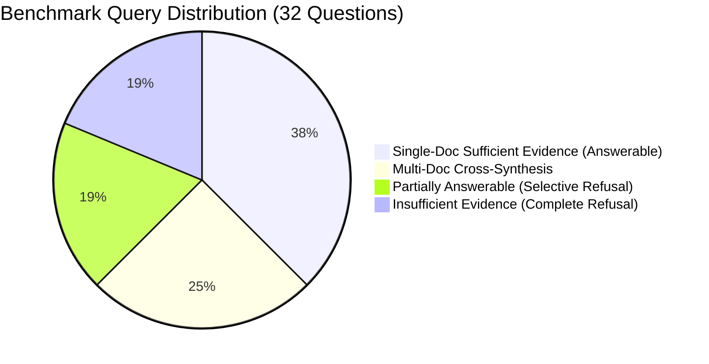

# VISTAAR Research Evaluation — Phase 2 Master Plan

**Document Version:** 1.0  
**Status:** Planned / Pre-Execution  
**Target:** Rigorous, Publication-Grade Evaluation of VISTAAR RAG for IEEE Research Paper  
**Scope:** Multi-document benchmark corpus, 4-tier query taxonomy, ablation of retrieval top-$k \in \{3, 5, 8\}$, retrieval + generation metrics, and cost/latency profiling.

---

## 1. Audit of Current Baseline & Architectural Ingestion Analysis

### 1.1 How VISTAAR Ingests & Indexes Documents
Inspection of the existing codebase (`backend/chunking.py`, `backend/embeddings.py`, `backend/vector_store.py`, `backend/qa_service.py`, and `evaluation/collect_eval_data.py`) confirms the exact pipeline:

1. **Ingestion (`backend/ingestion.py` / `chunking.py`):**
   - Documents (`.txt` or `.pdf` via `pypdf`) are loaded as a single contiguous string.
   - Fixed character-level sliding-window chunking is applied:
     $$\text{chunk\_size} = 1000 \text{ characters}, \quad \text{overlap} = 200 \text{ characters}, \quad \text{step} = 800 \text{ characters}$$
2. **Embedding Generation (`backend/embeddings.py`):**
   - Embeddings are generated using HuggingFace's `sentence-transformers/all-MiniLM-L6-v2`.
   - Dimension: $d = 384$.
   - Normalization: Raw Euclidean output (unnormalized L2).
3. **Vector Store (`backend/vector_store.py`):**
   - Vector indexing is managed by `faiss.IndexFlatL2(384)` (exact brute-force L2 distance).
   - In-memory index with parallel `stored_chunks` list in Python RAM.
4. **Context Construction & Prompting (`backend/qa_service.py`):**
   - Query embedding is computed via `model.encode([query])[0]`.
   - Nearest neighbors retrieved via `faiss.search(query_vec, k=8)`.
   - Chunks concatenated into a single prompt string:
     ```text
     Context:
     {chunk_1}

     ---

     {chunk_2}

     ...

     Question: {user_query}
     ```
   - LLM generation: Google Gemini with `temperature=0.0`.

### 1.2 Flaw in the Phase 1 Evaluation Setup
In Phase 1, the test corpus (`test_sample.txt`) was a single short text of 6,697 characters, resulting in **only 9 chunks**.
- Retrieving $k = 8$ chunks meant **$88.9\%$ of the entire corpus was injected into every single query prompt**.
- **Impact on Evaluation:**
  - True retrieval discrimination was untested (almost zero distractor chunks).
  - Context Recall was trivially $1.0$ because nearly the entire corpus was retrieved.
  - Context Precision was penalized simply because $k=8$ returned many irrelevant chunks even for single-fact questions.
  - Faithfulness was skewed when queries had no factual answer in the corpus.

Phase 2 replaces this toy setup with an academically defensible, multi-document corpus with controlled distractor density.

---

## 2. Realistic Multi-Document Test Corpus Design (50–100 Chunks)

To properly evaluate retrieval selectivity and rank precision, the evaluation corpus will consist of **5 distinct documents** generating between **60 and 80 chunks** (approx. 50,000–65,000 characters).

### 2.1 Corpus Breakdown

| Document ID | Title / Domain | Focus & Content | Target Chunks | Role in Benchmark |
| :--- | :--- | :--- | :--- | :--- |
| **DOC-01** | *VISTAAR System Architecture* | End-to-end architecture, document ingestion, sliding-window chunker, FAISS L2 vector store, Gemini generation layer, API contracts. | ~18 chunks | Primary source for direct architectural queries. |
| **DOC-02** | *Multimodal Ingestion & Indic Processing* | OCR pipeline (Tesseract/PaddleOCR), Indic language tokenization challenges, speech/audio transcription pipelines, tabular document extraction. | ~14 chunks | Source for cross-modal and multilingual queries. |
| **DOC-03** | *Comparative RAG Baselines* | Dense Passage Retrieval (DPR), BM25 lexical search, hybrid sparse-dense retrieval, GraphRAG, LangChain/LlamaIndex memory patterns. | ~14 chunks | Source for comparative and multi-hop queries. |
| **DOC-04** | *Hardware Profiling & Latency* | FAISS IndexFlatL2 vs IVF-PQ benchmarks, GPU vs CPU memory footprints, INT8/FP16 quantization, token latency, throughput scaling. | ~14 chunks | Source for performance and systems queries. |
| **DOC-05** | *Hard Distractor Corpus (Acoustic & Signal Processing)* | Audio signal sampling, Kalman filtering, spectral clustering, and Fourier transforms. Shares terminology (*"embeddings"*, *"vector distance"*, *"clustering"*, *"latency"*), but completely out-of-domain. | ~10 chunks | **Semantic distractors** to test retrieval robustness and hallucination resistance. |

### 2.2 Corpus Invariant
- Chunking method: Exact backend standard (`size=1000, overlap=200`).
- Total chunks: **~70 chunks**.
- With $k=3$, top-$k$ represents $\approx 4.3\%$ of the corpus.
- With $k=5$, top-$k$ represents $\approx 7.1\%$ of the corpus.
- With $k=8$, top-$k$ represents $\approx 11.4\%$ of the corpus.
- This creates realistic retrieval competition where $88\% - 95\%$ of chunks are distractors for any given query.

---

## 3. Benchmark Query Taxonomy (32 High-Quality Questions)

A 32-question evaluation suite covering 4 distinct query categories:



### 3.1 Taxonomy Breakdown

1. **Category A: Direct Single-Document Answerable (12 Questions)**
   - Evidence resides in 1–2 specific chunks of a single document.
   - Evaluates: Top-$k$ precision, answer faithfulness, reference correctness.
2. **Category B: Multi-Document Cross-Synthesis (8 Questions)**
   - Requires synthesizing evidence residing across 2 different documents (e.g., comparing DOC-01 system components with DOC-03 baseline algorithms or DOC-04 latency metrics).
   - Evaluates: Retrieval recall across disconnected chunks, multi-chunk LLM synthesis.
3. **Category C: Partially Answerable / Mixed Evidence (6 Questions)**
   - Queries ask for two related claims: one is explicitly supported in the corpus, while the other is completely absent.
   - Evaluates: Does the model answer the supported part and explicitly refuse the unsupported part, or does it hallucinate?
4. **Category D: Insufficient Evidence / Unanswerable (6 Questions)**
   - 3 completely out-of-domain queries.
   - 3 adversarial queries with deceptive lexical overlap with the distractor corpus (DOC-05).
   - Evaluates: Refusal calibration, zero-hallucination policy.

---

## 4. Ground-Truth Verification & Provenance Protocol

Every benchmark question is defined with deterministic ground-truth tracking:

```json
{
  "question_id": "PH2-Q01",
  "category": "sufficient_single",
  "question": "What vector similarity metric and index type does VISTAAR utilize for retrieval?",
  "ground_truth_chunks": [
    "DOC-01_chunk_004"
  ],
  "target_documents": ["DOC-01"],
  "reference_answer": "VISTAAR utilizes Euclidean distance (L2) with an exact brute-force FAISS IndexFlatL2 index.",
  "refusal_expected": false,
  "partial_scope": null,
  "verification_source": "DOC-01 paragraph 4: 'Embeddings are mapped into an exact L2 distance space using faiss.IndexFlatL2...'"
}
```

### 4.1 Annotation & Verification Rules
1. **Source Tracking:** Each ground-truth chunk is indexed with a deterministic SHA-256 fingerprint and chunk ID.
2. **Dual-Reviewer Rule:** Every reference answer must be independently verifiable directly from the ground-truth chunks without external assumptions.
3. **Refusal Explicit Criteria:** For unanswerable questions, the reference answer is formally defined as:
   `"The provided context does not contain sufficient information to answer this question."`
   This aligns with the Phase 1 corrected evaluation protocol.

---

## 5. Dataset Splitting & Separation Guarantees

To ensure academic validity and avoid test-set leakage:
- **Tuning / Validation Split (25%, 8 questions):** Used if prompt modifications or threshold experiments are explored.
- **Held-Out Test Benchmark (75%, 24 questions):** Completely frozen. Run once against each experimental condition.
- **Corpus Integrity:** Corpus documents are fixed and hashed (`corpus_manifest.json`) prior to running any evaluation script.

---

## 6. Experimental Matrix: Top-$k$ Ablation Study

Keeping all backend components strictly identical, we perform a controlled ablation study across top-$k$ configurations:

| Parameter | Configuration 1 | Configuration 2 (Balanced) | Configuration 3 (Baseline Default) |
| :--- | :--- | :--- | :--- |
| **Top-$k$ Chunks Retrieved** | **$k = 3$** | **$k = 5$** | **$k = 8$** (Current Baseline) |
| **Chunk Size & Overlap** | $1000 / 200$ (fixed) | $1000 / 200$ (fixed) | $1000 / 200$ (fixed) |
| **Embedding Model** | `all-MiniLM-L6-v2` (fixed) | `all-MiniLM-L6-v2` (fixed) | `all-MiniLM-L6-v2` (fixed) |
| **Index Structure** | `faiss.IndexFlatL2` (fixed) | `faiss.IndexFlatL2` (fixed) | `faiss.IndexFlatL2` (fixed) |
| **Generator LLM** | Gemini (`temp=0.0`) (fixed)| Gemini (`temp=0.0`) (fixed) | Gemini (`temp=0.0`) (fixed) |
| **Prompt Format** | Standard VISTAAR (fixed) | Standard VISTAAR (fixed) | Standard VISTAAR (fixed) |

### 6.1 Scientific Hypotheses for the Paper
1. **Hypothesis 1 (Precision vs. Recall Tradeoff):** $k=3$ will achieve the highest Retrieval Precision and RAGAS Context Precision, but may drop Retrieval Recall on multi-document cross-synthesis queries.
2. **Hypothesis 2 (Context Dilution in Generation):** $k=8$ provides maximum recall for multi-doc synthesis, but will introduce context dilution, slightly decreasing Faithfulness and increasing end-to-end latency.
3. **Hypothesis 3 (Sweet Spot):** $k=5$ provides the optimal Pareto frontier between retrieval recall, answer faithfulness, and token cost.

---

## 7. Comprehensive Metrics & Evaluation Engine

We compute two distinct tiers of metrics:

### 7.1 Tier 1: Deterministic Retrieval Metrics (LLM-Independent)
Evaluated directly on the FAISS output vectors against `ground_truth_chunks`:
- **Hit Rate @ $k$:** Binary indicator whether at least one ground-truth chunk appears in top-$k$.
- **Retrieval Precision @ $k$:** $\frac{|\text{Retrieved Chunks} \cap \text{Ground Truth Chunks}|}{k}$
- **Retrieval Recall @ $k$:** $\frac{|\text{Retrieved Chunks} \cap \text{Ground Truth Chunks}|}{|\text{Ground Truth Chunks}|}$
- **Mean Reciprocal Rank (MRR):** Reciprocal rank $\frac{1}{\text{rank}_1}$ of the first relevant chunk.

### 7.2 Tier 2: Generation & Alignment Metrics (Using Corrected Phase 1 Evaluator)
Evaluated using `evaluation/evaluate_ragas_corrected.py` with the fixes established in Phase 1:
- **Faithfulness:** Proportion of claims in the generated response grounded in retrieved contexts.
- **Answer Relevancy:** Evaluated and reported separately for Answerable queries vs. Refusal queries to prevent metric skew.
- **Context Precision (RAGAS):** Signal-to-noise ranking quality of the retrieved chunks.
- **Context Recall (RAGAS):** Reference answer coverage by the retrieved chunks.
- **Semantic Answer Similarity:** Embedding cosine similarity between response and reference answer.

### 7.3 Tier 3: Operational & Efficiency Profiling
- **Retrieval Latency:** FAISS search time (milliseconds).
- **Generation Latency:** Gemini API round-trip time (milliseconds).
- **Token Efficiency:** Character and token counts for Context vs. Generated Response.
- **API Cost Estimation:** Incurred Gemini token usage per query condition.

---

## 8. Directory & Deliverables Structure

All Phase 2 evaluation artifacts will be maintained in a clean, non-intrusive structure under `evaluation/`:

```text
evaluation/
├── phase2_evaluation_plan.md               # [THIS PLAN] Master specification
├── corpus/
│   ├── doc_01_vistaar_architecture.txt     # Ingestion & system specs
│   ├── doc_02_multimodal_indic.txt         # Modality & language processing
│   ├── doc_03_comparative_baselines.txt    # DPR, BM25, GraphRAG
│   ├── doc_04_hardware_latency.txt         # Profiling & quantization
│   ├── doc_05_acoustic_distractor.txt      # Hard negative distractor
│   └── corpus_manifest.json                # Chunk IDs, offsets & SHA-256 hashes
├── datasets/
│   ├── benchmark_queries_master.json       # 32 verified questions with chunk provenance
│   ├── tuning_queries.json                 # 8 validation queries
│   └── test_queries_frozen.json            # 24 held-out evaluation queries
├── runners/
│   ├── collect_phase2_runs.py              # Executes runs for k=3, k=5, k=8
│   └── evaluate_phase2_metrics.py          # Dual retrieval + RAGAS evaluation
└── results/
    └── phase2/
        ├── run_k3_results.json
        ├── run_k5_results.json
        ├── run_k8_results.json
        ├── ablation_summary_table.csv
        └── phase2_research_report.md       # Publication-ready LaTeX/Markdown tables
```

---

## 9. Next Steps for Implementation
Once this plan is approved:
1. Generate the 5 distinct, academically grounded evaluation documents (~70 chunks total).
2. Construct the 32-question master benchmark with verified chunk mappings.
3. Build the non-intrusive runner `runners/collect_phase2_runs.py` to collect real FAISS contexts and Gemini responses for $k \in \{3, 5, 8\}$.
4. Execute the evaluation using the corrected Phase 1 evaluator and generate comparative tables for the research paper.
